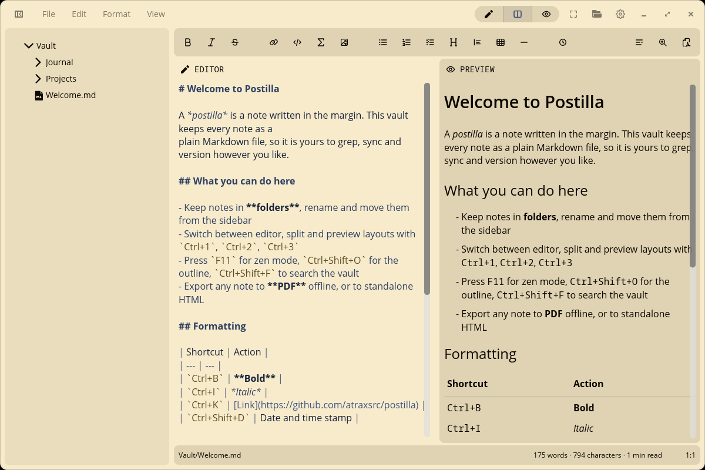
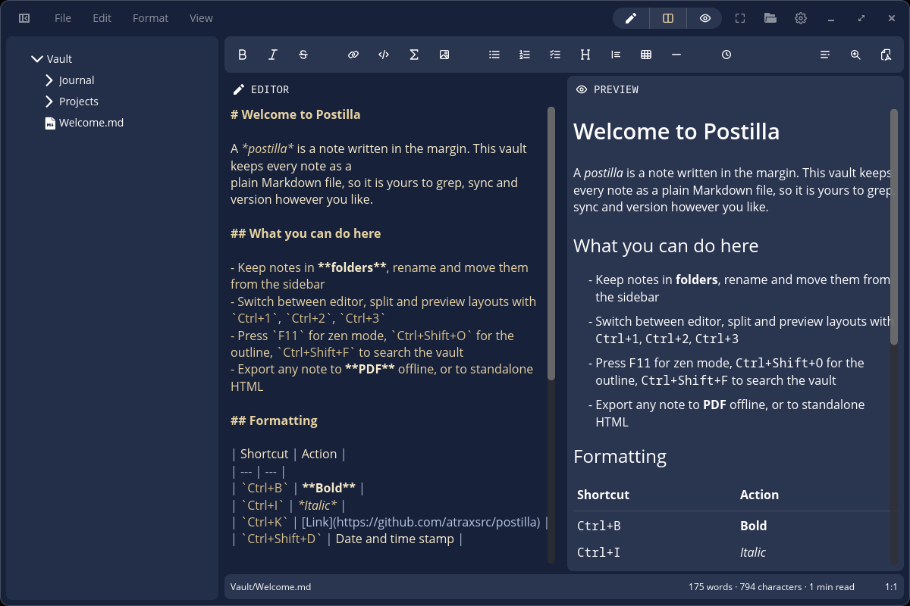

<div align="center">
<br>

<h1 align="center">Cedilla</h1>


<h3>A markdown text editor for the COSMIC™ desktop</h3>





<br><br>

<a href="https://flathub.org/apps/dev.mariinkys.Cedilla">

</a>
</div>

## Install

To install your COSMIC application, you will need [just](https://github.com/casey/just), if you're on Pop!\_OS, you can install it with the following command:

```sh
sudo apt install just
```

After you install it, you can run the following commands to build and install your application:

```sh
just build-release
sudo just install
```

### Testing this fork next to the Flathub Cedilla

This fork uses its own application id (`dev.mariinkys.Cedilla.Fork`), so it can be built, installed and run
side by side with the upstream Cedilla from Flathub: it has its own launcher entry ("Cedilla Fork"), its own
config, its own themes folder and its own default vault.

Build dependencies on Pop!\_OS / Ubuntu:

```sh
sudo apt install just pkg-config libxkbcommon-dev libwayland-dev libfontconfig-dev libfreetype-dev libexpat1-dev
```

Run it straight from the source tree without installing anything:

```sh
cargo run --release
```

To work on the notes of your existing Cedilla, open *Settings → General → Use another folder as vault* and pick
the vault of the other installation. Nothing is moved or copied, the fork just opens that folder. The Flatpak
keeps its vault in `~/.var/app/dev.mariinkys.Cedilla/data/dev.mariinkys.Cedilla/vault`, a native install in
`~/.local/share/dev.mariinkys.Cedilla/vault`.

## Features

- **Vault** of notes with folders, drag free move/rename, external change detection
- **Three layouts**: editor only, editor + live preview, preview only (`Ctrl+1` / `Ctrl+2` / `Ctrl+3`, or the switcher in the header bar)
- **Zen mode** (`F11`): hides every bar and the sidebar, leaving only your text
- **Clipboard**: cut / copy / paste / select all from the *Edit* menu, the editor right-click menu or the usual shortcuts; `Ctrl+V` pastes images straight into the note
- **Formatting**: bold, italic, strikethrough, code, links, quotes, tables, lists, headings, rules, date & time stamps (`Format` menu, help bar, or shortcuts such as `Ctrl+B`, `Ctrl+I`, `Ctrl+K`, `Ctrl+Shift+D`)
- **Outline** (`Ctrl+Shift+O`): jump between the headings of the document
- **Search in vault** (`Ctrl+Shift+F`): full text (or regex) search across every note, open a result at the matching line
- **Autosave** with a configurable delay
- **Export** to standalone HTML, copy as HTML, or export to PDF (Gotenberg)
- Word count, character count and reading time in the status bar
- **Fully customizable syntax highlighting**: import TextMate/Sublime `.tmTheme` files, COSMIC Terminal color schemes or simple Cedilla RON themes, and optionally paint the editor with the theme colors
- **Frosted glass** window effect with adjustable opacity on COSMIC

## Syntax highlighting themes

Cedilla ships the usual built-in themes (Inspired GitHub, Ocean, Mocha, Eighties, Solarized...) and
loads any theme placed in its themes folder (*Settings → Appearance → Themes folder*, or use
*Import theme…*). Three formats are detected automatically:

| Format | File | Notes |
| --- | --- | --- |
| **COSMIC Terminal color scheme** | `.ron` | The exact files COSMIC Terminal imports and exports. The 16 ANSI colors are mapped onto syntax scopes (keywords → magenta, strings → green, functions → blue, headings → bright blue…). |
| **Cedilla theme** | `.ron` | A flat list of named colors: `keyword`, `string`, `heading`, `link`… plus optional raw TextMate scope overrides. See [`resources/themes/example-cedilla-theme.ron`](./resources/themes/example-cedilla-theme.ron). |
| **TextMate / Sublime theme** | `.tmTheme` | Any theme from the Sublime Text ecosystem. |

```ron
// A minimal Cedilla theme
(
    name: "Mine",
    background: "#1e1e2e",
    foreground: "#cdd6f4",
    comment: "#6c7086",
    keyword: "#cba6f7",
    string: "#a6e3a1",
    heading: "#89b4fa",
    link: "#74c7ec",
    scopes: { "entity.name.function.macro": "#f5c2e7" },
)
```

Pick a theme for light and for dark mode independently. Turn on *Use highlighter theme colors* to paint the
editor and the preview code blocks with the theme's own background and text colors (great with terminal themes).

## Frosted glass

Under *Settings → Window* you can set the frosted glass behaviour (*Follow desktop*, *Enabled*, *Disabled*) and the
window opacity. Blur behind the window is provided by the compositor, so it needs COSMIC with blur support; on other
desktops the window simply becomes translucent.

## Typst Support

The app has some support for [Typst](https://typst.app/) inside `code` blocks. This has been added specially for math and formulas; other Typst features may not work correctly. (But you're free to try). You can add Typst using `typ` or `typst` as the languge attribut inside a `code` block.

<div align="center">
    
</div>

## Mermaid Support

The app has support for [Mermaid](https://mermaid.js.org/intro/) Diagrams inside `code` blocks. You can add Mermaid Diagrams using `mmd` or `mermaid` as the languge attribut inside a `code` block. Mermaid Diagrams support in Cedilla is powered by the awesome [merman](https://github.com/Latias94/merman) crate!

<div align="center">
    
</div>
    
## Attribution

> "[Pop Icons](http://github.com/pop-os/icon-theme)" by [System76](http://system76.com/) is licensed under [CC-SA-4.0](http://creativecommons.org/licenses/by-sa/4.0/)

> For Markdown and HTML rendering this app uses the amazing work of [Mrmayman](https://github.com/Mrmayman) with [Frostmark](https://github.com/Mrmayman/frostmark). (Adapted to work with libcosmic and other changes/improvments by me)

## Copyright and Licensing

Copyright 2026 © Alex Marín

Released under the terms of the [GPL-3.0](./LICENSE)
